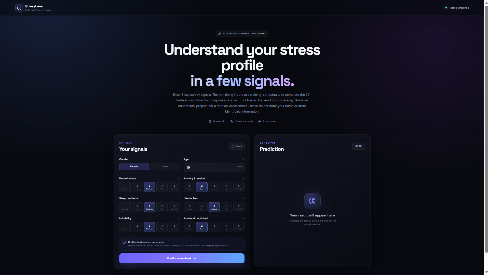
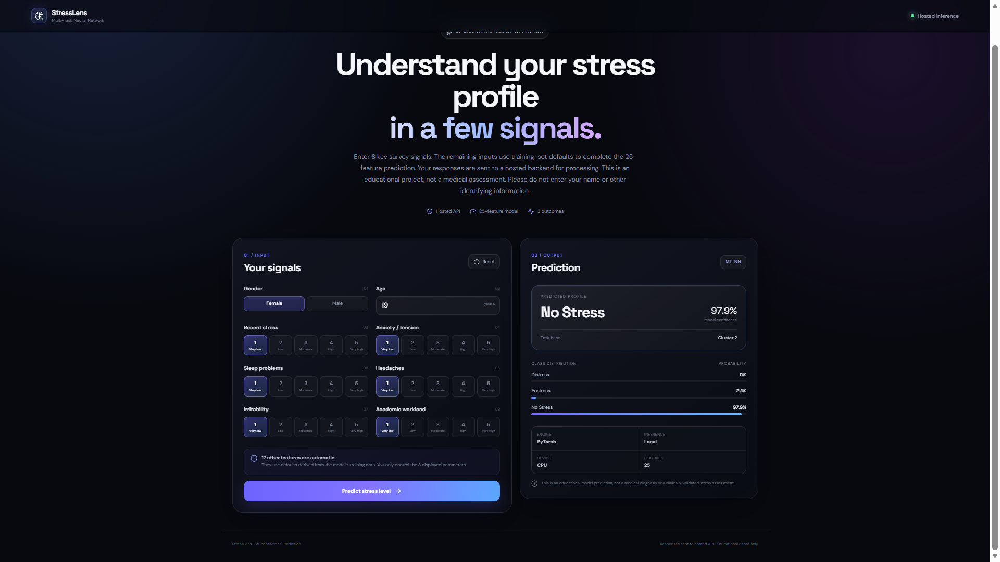
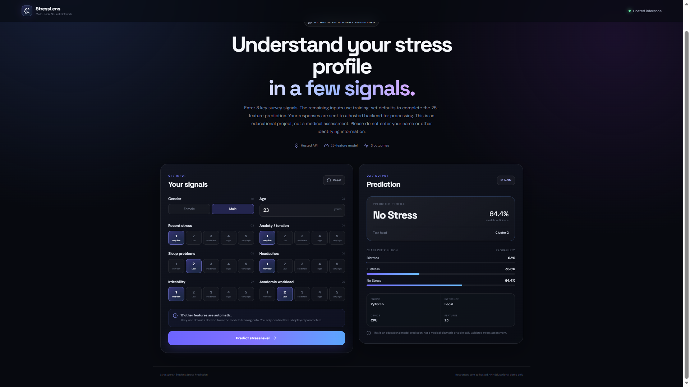

# StressLens — Student Stress Level Prediction

A student project that uses a Multi-Task Neural Network
to predict student stress profiles from selected survey inputs.

## 🌐 Live Demo

**Try StressLens:** https://student-stress-level.vercel.app/

## ✨ Features

- Interactive student survey form
- Eight user-controlled input parameters
- Automatic defaults for the remaining model features
- Stress profile prediction
- Class probability distribution
- Responsive web interface

## 🛠️ Technology Stack

- Frontend: React and Vite
- Backend: Django and Python
- Machine Learning: PyTorch
- Frontend Hosting: Vercel
- Backend Hosting: Render

## ⚠️ Disclaimer

StressLens is an educational machine-learning project.
Its predictions are not a medical diagnosis or a
clinically validated measurement of stress.

## What this project uses

- **Model:** Multi-Task Neural Network (PyTorch)
- **Architecture:** 25 inputs → 64-unit shared layers → 2 cluster-specific task heads → 3 classes
- **Backend:** Django
- **Frontend:** React + Vite
- **Inference:** local machine only
- **GPU:** automatically uses CUDA when the installed PyTorch build exposes CUDA; otherwise CPU
- **User inputs:** 8 parameters
- **Automatic inputs:** remaining 17 features use training-set defaults
- **Output:** Distress / Eustress / No Stress + probability distribution + model device

The supplied architecture file specifies `input_dim=25`, `hidden_dim=64`, `n_classes=3`, and `n_tasks=2`.

---

## 🖥️ Application Screenshots

StressLens provides a modern web interface for student stress-profile prediction using a Multi-Task Neural Network.

### 1. Stress Assessment Input Form

Enter the eight available parameters to generate a stress-profile prediction. The remaining 17 features are automatically populated using training-set defaults.



### 2. Stress Prediction Results — Example 1

The application displays the predicted stress category, model confidence, selected task head, and class probability distribution.



### 3. Stress Prediction Results — Example 2

A second example demonstrates the prediction interface with different input values and a different probability distribution.



---

## Windows setup

### 1. Open PowerShell / Command Prompt

From the project root:

```powershell
py -m venv .venv
```

Activate:

```powershell
.venv\Scripts\activate
```

If PowerShell blocks activation, use:

```powershell
Set-ExecutionPolicy -Scope Process -ExecutionPolicy Bypass
.venv\Scripts\activate
```

### 2. Install Python dependencies

```powershell
python -m pip install --upgrade pip
pip install -r backend\requirements.txt
```

### 3. Start everything

You only need:

```powershell
python app.py
```

On the first run, `app.py` automatically runs `npm install` inside `frontend`.

Then open:

```text
http://127.0.0.1:5173
```

Do **not** open port 8000 for the UI. Port 8000 is the Django API.

## If Node.js is not installed

Install Node.js LTS, reopen the terminal, verify:

```powershell
node --version
npm --version
```

Then:

```powershell
python app.py
```

## Optional: verify the backend

With the app running:

```powershell
curl http://127.0.0.1:8000/api/health/
```

Expected response includes:

```json
{
  "status": "ok",
  "model": "Multi-Task Neural Network"
}
```

## Project structure

```text
StressLens/
├── app.py
├── README.md
├── .gitignore
├── data/
├── Results/
├── docs/
│   └── screenshots/
├── models/
├── backend/
├── frontend/
└── Stress_Level_Prediction_Experiments.ipynb
```

## Important model detail

The original training pipeline routes every sample through a **K-Means cluster-specific neural-network head**. Therefore deployment needs the K-Means model in addition to the neural-network weights.

The original notebook also standardizes the 25 survey features before K-Means and neural-network inference.

## The 8 visible inputs

1. Gender
2. Age
3. Recent stress
4. Anxiety / tension
5. Sleep problems
6. Headaches
7. Irritability
8. Academic workload

The other 17 inputs are automatically filled with training-set defaults.

## GPU note

The application detects:

```python
torch.cuda.is_available()
```

and uses CUDA when available. The UI reports whether inference is using an RTX GPU or CPU.

Your RTX 4050 is more than sufficient for this model. Because this dataset/model is small, GPU inference will not necessarily be faster than CPU inference; the app still supports CUDA for local execution.

## Model output classes

The supplied label encoder maps the three classes to:

- Distress
- Eustress
- No Stress

The UI displays the short labels while preserving the original full class labels in the backend result.

## Troubleshooting

### `ModuleNotFoundError: django`

Activate the virtual environment and run:

```powershell
pip install -r backend\requirements.txt
```

### `npm is not recognized`

Install Node.js LTS, reopen the terminal, then:

```powershell
node --version
npm --version
python app.py
```

### Port 8000 already in use

Stop the existing Django process, or change the backend port in `app.py` and the Vite proxy in `frontend\vite.config.js`.

### Port 5173 already in use

Stop the existing Vite process, or change the Vite port in `frontend\vite.config.js`.

## Notes

This is a local ML demonstration/deployment. The prediction is not a medical diagnosis or clinical assessment.
